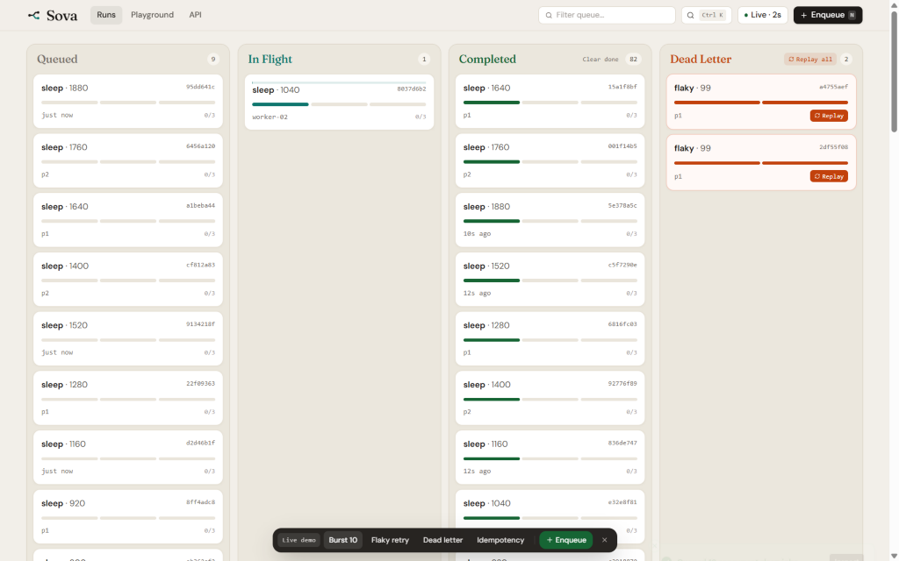
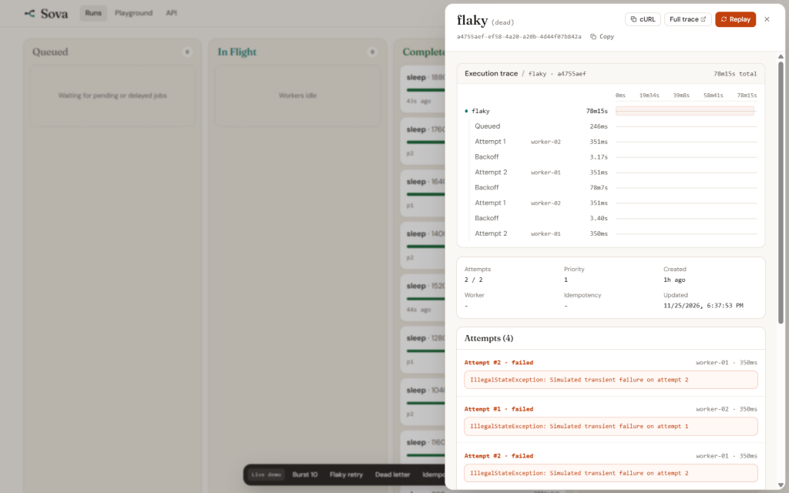
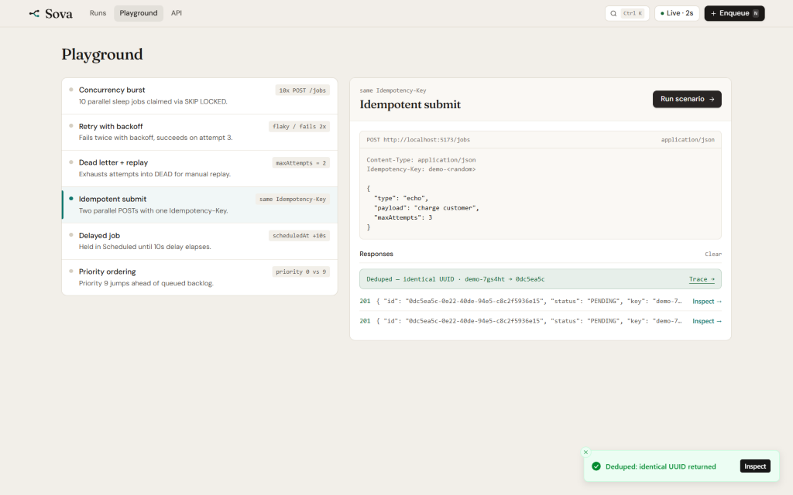

# Sova — Distributed Job Scheduler & Queue Console

[](https://github.com/lithincg/sova/actions/workflows/ci.yml)


A distributed background job scheduler built with **Java 21, Spring Boot 3.4, PostgreSQL 16, Redis 7.2, Flyway, React 18, and Docker**. Multiple worker instances claim work concurrently without double-execution via PostgreSQL row locking (`FOR UPDATE SKIP LOCKED`), renew short-lived Redis heartbeats while executing, record per-attempt execution traces, and recover crashed jobs automatically through a background reaper.



---

## Verified Capabilities & Checks

Every core concurrency, durability, and retry invariant is enforced in PostgreSQL / domain constraints and backed by automated JUnit 5 + Testcontainers integration checks (`./mvnw verify`):

| Capability | Mechanism | Verification |
|---|---|---|
| **Race-free concurrent claiming** | Single atomic CTE `SELECT ... FOR UPDATE SKIP LOCKED` + `UPDATE ... RETURNING` backed by partial index `idx_jobs_claimable` (`WHERE status = 'PENDING'`) | `JobClaimingAndReaperIT.concurrentWorkers_claimEveryJobExactlyOnceWithoutDuplicates` — **8 parallel worker threads claiming 40 jobs**: verified `40` claimed and `40` unique IDs (**0 double-claims, 0 lost jobs**) |
| **Worker crash recovery (at-least-once)** | Redis TTL heartbeat keys (`sova:hb:<jobId>`, `30s` TTL refreshed every `10s`); `JobReaper` scans `idx_jobs_in_flight` every `15s` (after `15s` claim grace) | `JobClaimingAndReaperIT.reaper_requeuesCrashedJobWhenHeartbeatMissing` — verifies expired heartbeat requeues `PENDING`, clears `claimedBy`, increments attempts, and writes a `REAPED` audit row |
| **Attempt history & waterfall timing** | `V3__add_job_attempts.sql` (`job_attempts` indexed by `(job_id, id)`) tracks worker ID, outcome (`SUCCEEDED \| FAILED \| REAPED`), error, and `duration_ms` | `JobClaimingAndReaperIT.failureThenSuccess_recordsOrderedAttemptHistory` & `JobServiceTest` — verifies ordered `FAILED -> SUCCEEDED` attempt trace |
| **Guarded state machine & backoff** | `Job` entity enforces legal transitions (`PENDING -> CLAIMED -> RUNNING -> SUCCEEDED \| PENDING \| DEAD`), exponential backoff (`5s` base, `300s` cap + jitter), and manual DLQ replay | `JobStateMachineTest` (**4 unit tests**) — verifies illegal transition guards, `5 * 2^attempt + jitter` schedule calculation, crash requeue caps, and `DEAD -> PENDING` replay |
| **Idempotent enqueue** | Optional `Idempotency-Key` request header backed by unique partial index `idx_jobs_idempotency_key` (`WHERE idempotency_key IS NOT NULL`) | Tested via live Playground (`Idempotent submit` returning identical job UUID across parallel `POST /jobs` calls) and `JobService` conflict checks |
| **Graceful worker drain** | Spring Boot graceful shutdown (`20s` phase timeout) lets active executions release heartbeats cleanly before exit | Configured in `application.yml` (`server.shutdown: graceful`) |

---

## Pipeline Console

Sova ships a Vite + React 18 TypeScript UI bundled directly into the Spring Boot container via a multi-stage Docker build (`frontend/dist/` → `src/main/resources/static/`):

- **Swimlane Board (`#/jobs`):** Four real-time columns (**Queued**, **In Flight**, **Completed**, **Dead Letter**) with animated flight bars, segmented attempt meters, live backoff countdowns, `Clear done` toggle, and one-click single or batch **`Replay all`** for dead-letter jobs.
- **Execution Trace Drawer & Job Detail (`#/jobs/:id`):** Slide-over Vaul drawer and dedicated detail route rendering waterfall `<WaterfallTrace />` spans per attempt/backoff gap, worker IDs, error callouts, `cURL` generator, and raw JSON.
- **Interactive Playground (`#/playground`):** Six built-in API scenarios (*Concurrency burst*, *Retry with backoff*, *Dead letter + replay*, *Idempotent submit*, *Delayed job*, *Priority ordering*) showing raw `POST /jobs` payloads, dedupe banners, and clearable response logs.
- **Keyboard Navigation:** Press `Ctrl K` / `Cmd K` to open the command palette or `N` to open the Enqueue job drawer.

| Trace Waterfall Inspector | Live Idempotency Playground |
|---|---|
|  |  |

---

## REST API

| Method | Path | Description |
|---|---|---|
| `POST` | `/jobs` | Enqueue job (`type`: `echo \| sleep \| flaky`, `payload`, `priority`, `maxAttempts`, optional `scheduledAt`); supports `Idempotency-Key` |
| `GET` | `/jobs` | List the 200 most recent jobs (optional `?status=PENDING \| CLAIMED \| RUNNING \| SUCCEEDED \| DEAD`) |
| `GET` | `/jobs/stats` | Live job counts grouped by `JobStatus` |
| `GET` | `/jobs/{id}` | Fetch single job metadata and state |
| `GET` | `/jobs/{id}/attempts` | Fetch ordered execution attempts (`attemptNumber`, `workerId`, `outcome`, `error`, `startedAt`, `finishedAt`, `durationMs`) |
| `POST` | `/jobs/{id}/replay` | Reset a `DEAD` job back to `PENDING` with `attempts = 0` |
| `GET` | `/health` | Plain status probe |
| `GET` | `/api/info` | Service metadata & endpoint summary |

---

## Observability & Metrics

Spring Boot Actuator exposes `/actuator/health`, `/actuator/info`, `/actuator/metrics`, and `/actuator/prometheus` (tagged with `application=sova`), plus structured MDC logging (`workerId`, `jobId`).

Sova emits the following application counters from `JobExecutionService`:

| Metric | Tags | Description |
|---|---|---|
| `sova.jobs.completed` | `status=succeeded` \| `status=dead` | Total terminal job outcomes recorded by workers |
| `sova.jobs.retried` | — | Transient execution failures rescheduled with exponential backoff |
| `sova.jobs.reclaimed` | — | Stale in-flight jobs reclaimed by `JobReaper` after missed Redis heartbeats |

---

## Run Locally

### Full 2-Worker Stack (Docker Compose)
Starts PostgreSQL 16, Redis 7.2, and two independent worker instances (`worker-1` on `:8080`, `worker-2` on `:8081`):

```bash
docker compose up --build
```

- Console & API (Worker 1): `http://localhost:8080`
- Console & API (Worker 2): `http://localhost:8081`

### Quick `curl` Examples

```bash
# Submit an echo job
curl -X POST http://localhost:8080/jobs \
  -H "Content-Type: application/json" \
  -d '{"type":"echo","payload":"hello sova","priority":5}'

# Submit a flaky job (fails once, retries with backoff, succeeds on attempt 2)
curl -X POST http://localhost:8080/jobs \
  -H "Content-Type: application/json" \
  -d '{"type":"flaky","payload":"1","maxAttempts":3}'

# Idempotent submission (repeated calls return the exact same UUID)
curl -X POST http://localhost:8080/jobs \
  -H "Content-Type: application/json" \
  -H "Idempotency-Key: order-4821" \
  -d '{"type":"echo","payload":"charge customer"}'

# Inspect execution attempt trace or replay a dead job
curl -s http://localhost:8080/jobs/<job-uuid>/attempts
curl -X POST http://localhost:8080/jobs/<job-uuid>/replay
```

### Frontend Development

```bash
cd frontend
npm install
npm run dev    # Proxies /jobs, /actuator, /health, /api -> http://localhost:8080
npm run build  # Type-check (tsc -b) + Vite production bundle
```

---

## Tests

```bash
# Fast unit suite (no Docker required)
./mvnw test

# Full unit + Testcontainers PostgreSQL 16 integration suite (requires Docker)
./mvnw verify
```

- `JobStateMachineTest` (**4 unit tests**): legal/illegal state transitions, exponential backoff math, DLQ capping, crash requeue & replay
- `JobServiceTest` (**7 unit tests**): submission defaults, attempt history lookup & 404 handling, replay conflict guards
- `JobClaimingAndReaperIT` (**3 Testcontainers PostgreSQL 16 integration tests**): 8-thread concurrent claiming (`40` jobs / `0` double-claims), reaper heartbeat expiration recovery (`REAPED` history), ordered retry-then-success trace
